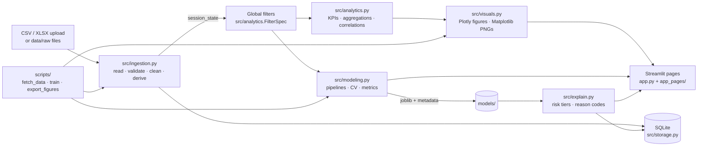

# Education Analytics Dashboard

A Streamlit dashboard for **descriptive, diagnostic and predictive analytics** on secondary-school
student data. Upload the UCI Student Performance files (or your own data in the same format) to
explore what relates to final grades, compare models that predict pass/fail, and get an
**early-warning list of at-risk students with plain-language reasons** for each one.

> Every number on screen is computed at runtime from the data you load. Nothing is hard-coded.

## Features

| Page | What it does |
|---|---|
| **Home** | Project summary, live dataset status and KPIs, navigation guide |
| **Data Ingestion** | Multi-file CSV/XLSX upload, subject auto-detection, schema validation report, data-quality flags, missing-value summary, preview, CSV template, SQLite upload history |
| **Executive Overview** | KPI tiles (records, mean/median G3, pass/fail %, pass % per subject), pass/fail and subject donuts, pass rate by subject and school, summary and descriptive tables |
| **Exploratory Analysis** | G3 histogram (pass/fail), box plots by subject and higher-education aspiration, mean G3 by study time and failures, pass rate by absence band, G2–G3 scatter, correlation bar and heatmap, one-click 300-dpi PNG export |
| **Model Evaluation** | Settings A and B × 3 models vs majority-class baseline (5-fold CV, mean ± std), class-weight toggle, live threshold slider, confusion matrix, ROC curves, recall/precision trade-off, Random Forest importance, Logistic Regression coefficients, save model with metadata |
| **Early Warning** | Risk tiers (High ≥ 0.7, Medium 0.4–0.7, Low < 0.4), risk donut and distribution, searchable at-risk table with top-3 reasons, CSV export, prediction history in SQLite |
| **Methodology** | Citation, pipeline, metric definitions, limitations, privacy and fairness |

Global sidebar filters (subject, school, sex, address, age range, exclude G3 = 0) apply to every
analysis page.

## Architecture



Design principles: pages hold no business logic (they only call `src/`); pure, typed,
documented functions; all configuration in `src/config.py`; `pathlib` only; fixed seeds;
Streamlit caching for evaluation and scoring.

```
├── app.py                      # entry point: navigation, global filters, landing page
├── app_pages/                  # 1_Data_Ingestion … 6_Methodology
├── src/
│   ├── config.py               # paths, schema, constants, design tokens
│   ├── ingestion.py            # load, validate, clean, merge, derive, quality summary
│   ├── analytics.py            # filters, KPIs, aggregations, correlations
│   ├── visuals.py              # Plotly builders + Matplotlib exports
│   ├── modeling.py             # pipelines, CV, metrics, persistence, inference
│   ├── explain.py              # risk tiers and per-student reason codes
│   ├── storage.py              # SQLite: uploads and prediction runs
│   └── ui.py                   # shared Streamlit components and theme CSS
├── scripts/                    # fetch_data.py · train.py · export_figures.py
├── data/{raw,processed}/       # inputs and cleaned dataset (git-ignored)
├── models/                     # saved models (git-ignored)
├── reports/{figures,metrics}/  # exported PNGs and metrics reports (git-ignored)
├── tests/                      # pytest suite
└── .streamlit/config.toml      # theme
```

> Pages live in `app_pages/` rather than `pages/` so that `st.navigation` controls the grouped
> sidebar on every URL (a `pages/` folder triggers Streamlit's automatic navigation instead).

## Setup

Requires **Python 3.10+**. Pinned versions in `requirements.txt` are tested on 3.10 and 3.13.

```bash
python -m venv .venv
```

Activate the environment:

| Shell | Command |
|---|---|
| macOS / Linux | `source .venv/bin/activate` |
| Windows PowerShell | `.\.venv\Scripts\Activate.ps1` (if blocked: `Set-ExecutionPolicy -Scope CurrentUser RemoteSigned`) |
| Windows CMD | `.venv\Scripts\activate.bat` |

```bash
pip install -r requirements.txt
```

## Usage

```bash
streamlit run app.py
```

Then open **Data Ingestion** and upload `student-mat.csv` and/or `student-por.csv` (or any file
with the same 33 columns). If both files are in `data/raw/`, a **Use bundled UCI dataset** button
appears instead.

### Getting the dataset

Download from the [UCI repository](https://archive.ics.uci.edu/dataset/320/student+performance),
unzip `student+performance.zip`, then `student.zip`, and place `student-mat.csv` and
`student-por.csv` in `data/raw/`. Or let the script do it:

```bash
python scripts/fetch_data.py
```

It prints manual instructions if the download fails, then validates the files and prints a
data-quality summary.

### Command-line tools

```bash
python scripts/train.py
```

Cross-validates all models for settings A and B, writes `reports/metrics/metrics.md` and
`metrics.json`. Options: `--input FILES`, `--balanced`, `--exclude-g3-zero`,
`--save random_forest --setting B --threshold 0.5`.

```bash
python scripts/export_figures.py
```

Writes all 12 charts as 300-dpi PNGs to `reports/figures/`.

## Results

Generate the results table on the real dataset with `python scripts/train.py`. It writes
`reports/metrics/metrics.md` in this format (mean ± std over 5 stratified folds, threshold 0.5):

| Setting | Model | Accuracy | Precision (pass) | Recall (pass) | F1 (pass) | ROC-AUC | Fail-class recall | Fail-class precision |
|---|---|---|---|---|---|---|---|---|
| A | Majority-class baseline | _run train.py_ | | | | | | |
| A | Logistic Regression | | | | | | | |
| A | Decision Tree | | | | | | | |
| A | Random Forest | | | | | | | |
| B | Majority-class baseline | | | | | | | |
| B | Logistic Regression | | | | | | | |
| B | Decision Tree | | | | | | | |
| B | Random Forest | | | | | | | |

Paste the generated table here once you have run it on the real data.

### Exported figures

| File | Description |
|---|---|
| `01_g3_distribution.png` | Distribution of final grades (G3), pass vs fail |
| `02_pass_rate_by_subject.png` | Pass rate by subject, with group sizes |
| `03_pass_rate_by_school.png` | Pass rate by school, with group sizes |
| `04_mean_g3_by_studytime.png` | Mean G3 by weekly study time (±1 SE) |
| `05_mean_g3_by_failures.png` | Mean G3 by number of past failures (±1 SE) |
| `06_pass_rate_by_absence_band.png` | Pass rate by absence band |
| `07_g3_box_by_subject.png` | G3 box plots by subject |
| `08_g3_box_by_higher.png` | G3 box plots by higher-education aspiration |
| `09_g2_vs_g3_scatter.png` | Second-period vs final grade (jittered) |
| `10_correlation_with_g3.png` | Correlation of numeric attributes with G3 |
| `11_correlation_heatmap.png` | Correlation heatmap of numeric attributes |
| `12_pass_fail_donut.png` | Share of passing vs failing records |

## Screenshots

<!-- Replace with real screenshots after loading the UCI data. -->
| Page | Screenshot |
|---|---|
| Home | _docs/screenshots/home.png_ |
| Data Ingestion | _docs/screenshots/ingestion.png_ |
| Executive Overview | _docs/screenshots/overview.png_ |
| Exploratory Analysis | _docs/screenshots/exploratory.png_ |
| Model Evaluation | _docs/screenshots/model_evaluation.png_ |
| Early Warning | _docs/screenshots/early_warning.png_ |

## Design system

Flat UI: no shadows, 2px radius, hairline borders. Colours come from one validated,
colour-blind-safe palette (`src/config.py`):

- **Pass = blue, Fail = orange with a diagonal hatch** and a text label, so pass and fail are
  never told apart by colour alone. Orange is reserved for "Fail".
- Other series use blue, aqua and yellow (checked pairwise for colour-vision deficiencies).
- Correlations use a red ↔ grey ↔ blue diverging scale centred on zero.
- Risk tiers use reserved status colours **plus an icon (▲ ◆ ●), a label and a pattern**.
- Every chart has a "Show data" table view.

## Testing and quality

```bash
pytest
```

```bash
ruff check . && ruff format --check .
```

The test suite covers ingestion, analytics, visuals, modelling, explanations, storage and the
CLI scripts, with coverage reported for `src/` (presentation helpers in `src/ui.py` are
verified by rendering instead).

## Limitations

- Two schools in one region of Portugal, 2005–2006: results may not generalise.
- Self-reported, coarse attributes (study time, alcohol use, family relationships).
- Correlation is not causation; importances and reason codes describe the model, not causes.
- Class imbalance: read fail-class recall/precision against the baseline, not accuracy alone.
- G3 = 0 rows likely mean non-appearance; results change if they are excluded.
- Some students appear in both subject files; there is no student ID, so matching is
  approximate and the same student can fall in training and test folds.
- Early Warning usually scores the students the model was trained on, so probabilities are
  optimistic; use it on new cohorts.
- Student data is personal: upload only what you are authorised to process, and treat flags as a
  prompt for supportive human review, never as a decision. Check error rates across groups.

## Next steps

- Group-aware cross-validation once a real student ID is available.
- Probability calibration and per-group fairness metrics on the Model Evaluation page.
- Optional persistent storage (e.g. a managed database) for multi-user deployments.

## Citation

P. Cortez and A. Silva. *Using Data Mining to Predict Secondary School Student Performance.*
In A. Brito and J. Teixeira (Eds.), Proceedings of 5th FUture BUsiness TEChnology Conference
(FUBUTEC 2008), pp. 5-12, Porto, Portugal, April 2008, EUROSIS.
